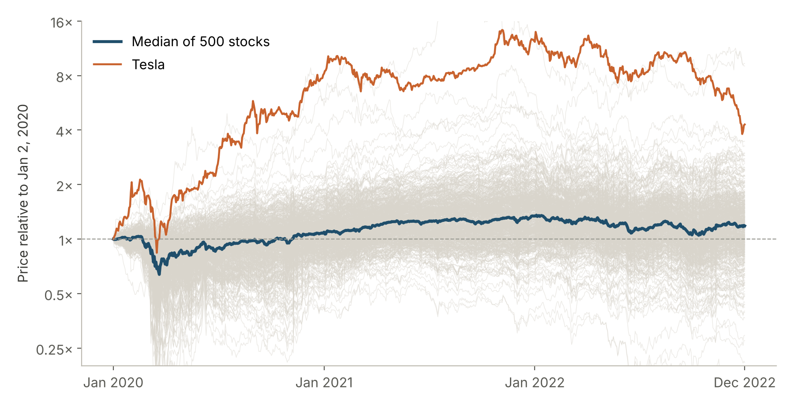
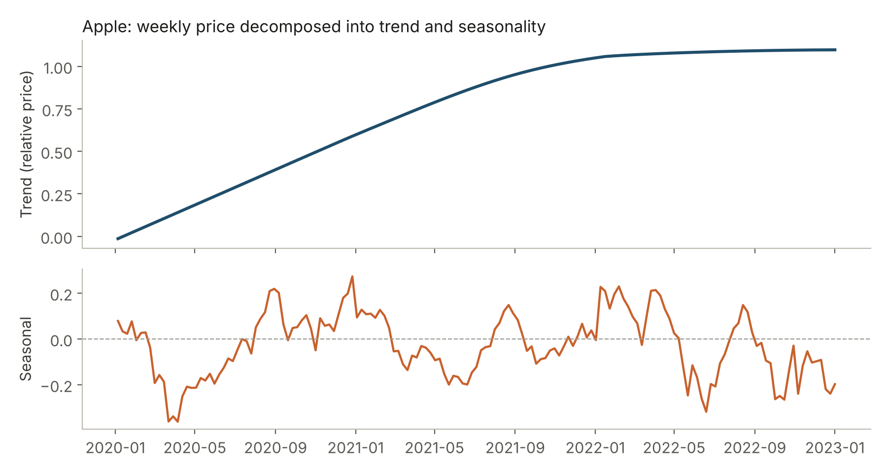
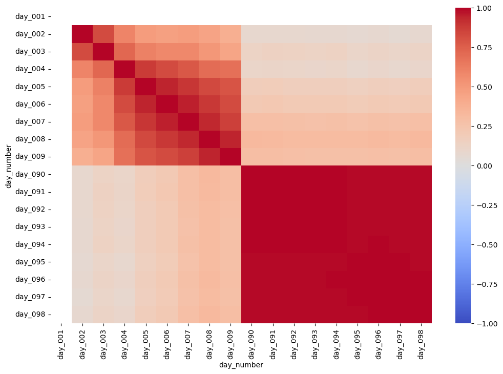
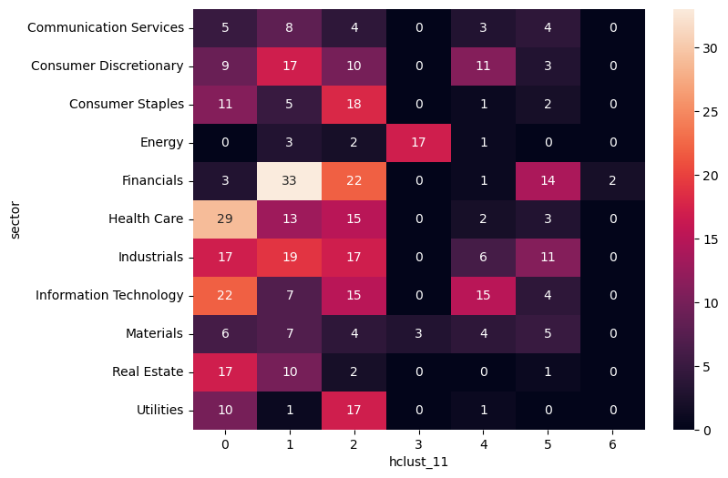
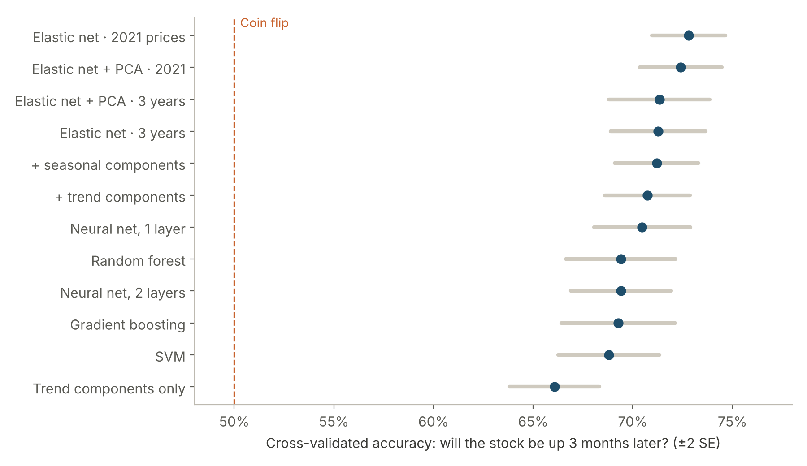

# Can a model beat a coin flip on the S&P 500?

**Predicting whether an S&P 500 stock will be up three months later, using time-series decomposition, PCA and machine learning**

If you bought a stock at the end of 2022, would it be worth more three months later? This project frames that as a classification problem for every company in the S&P 500. It uses three years of daily closing prices, from January 2020 to December 2022, covering the pandemic crash, the tech boom and the tech bust.



*Every S&P 500 stock's price relative to its first trading day of 2020 (log scale). The median stock (blue) ended the period not far from where it started. Tesla (orange) is a reminder of how wide the spread is.*

---

## The question

- **Inputs:** each company's daily closing prices for 2020–2022, expressed relative to its price on the first trading day, plus features derived from them.
- **Target:** an *event* is a stock whose price on **April 1, 2023** is higher than at the end of 2022, meaning you would have made money holding it for three months.
- **Baseline:** events and non-events are roughly balanced, so a coin flip scores about **50%**.

## Data

- Daily closing prices for **500 S&P 500 companies in 11 sectors**, pulled from Yahoo Finance with the R package [`tidyquant`](https://business-science.github.io/tidyquant/): **378,000 prices** in total.
- April 2023 closing prices to define the outcome.

## Approach

| Step | Notebook | What it does |
|---|---|---|
| 1 | [`01_eda.ipynb`](notebooks/01_eda.ipynb) | Cleans the data, converts prices to relative prices, explores correlations, and runs a first PCA |
| 2 | [`02_time_series_decomposition.ipynb`](notebooks/02_time_series_decomposition.ipynb) | Resamples each stock to weekly prices and uses **STL decomposition** to split it into trend and seasonal components |
| 3 | [`03_clustering_pca.ipynb`](notebooks/03_clustering_pca.ipynb) | Runs **PCA** and **hierarchical clustering (Ward)** on the trend and seasonal components to find groups of stocks that move together |
| 4 | [`04_linear_models.ipynb`](notebooks/04_linear_models.ipynb) | **Elastic-net logistic regression** on raw prices, PCA scores and trend/seasonal features, with cross-validated tuning |
| 5 | [`05_nonlinear_models.ipynb`](notebooks/05_nonlinear_models.ipynb) | **Neural networks, SVM, random forest and gradient-boosted trees** on the PCA-compressed trend and seasonal features |

### Decomposing each stock

Each stock's weekly price was split into a smooth **trend** and a repeating **seasonal** pattern. Both became model features.



### Structure in the market

- Prices on nearby trading days are highly correlated, and the correlation fades as days get further apart.

  

- **The first principal component explains over 70% of the variation in prices**, so most stocks move together.
- Clustering the decomposed trends separated the **energy** sector into its own cluster (17 of its 23 stocks), and clustering the seasonal components picked out **utilities**.

  

## Results



- Every model beat the coin flip comfortably. Cross-validated accuracies ranged from about **66% to 73%**.
- The **best model reached about 72% accuracy on the held-out test set**, despite the data spanning a pandemic crash and a boom-and-bust cycle in tech.
- Elastic-net logistic regression was as good as the more complex non-linear models. The neural network with one hidden layer was the best of the non-linear group, at about 70.5%.
- Adding trend and seasonal components did not improve accuracy beyond the raw relative prices. Most of the signal is already in the shared market movement that the first principal component captures.
- The 2020 data, the pandemic year, was the hardest period to predict.

## Repository structure

```
.
├── notebooks/                       # analysis, run in order (Python)
│   ├── 01_eda.ipynb
│   ├── 02_time_series_decomposition.ipynb
│   ├── 03_clustering_pca.ipynb
│   ├── 04_linear_models.ipynb
│   └── 05_nonlinear_models.ipynb
├── reports/                         # rendered HTML copies of each notebook
├── scripts/                         # R scripts that download prices with tidyquant
│   ├── get_sp500_prices_2020_2022.R
│   └── get_sp500_prices_april_2023.R
├── data/                            # included price data and intermediate files
├── models/                          # fitted models are saved here (not tracked)
└── figures/                         # plots used in this README
```

## How to run

1. **Get the price data.** Run the R scripts in `scripts/` (they need `tidyverse` and `tidyquant`) and save their output in `data/`. The 2020–2022 files the notebooks read (`sp500_stock_20_22_close_with_sector_long_format.csv` and `..._wide_format.csv`) are not included in the repository. The April 2023 file, an earlier 2022 pull and the processed modelling table (`wf_final_df.csv`) are included.
2. **Install the Python packages:** `pandas`, `numpy`, `matplotlib`, `seaborn`, `scikit-learn`, `scipy`, `statsmodels` and `patsy`.
3. **Run the notebooks in `notebooks/` in order.** Fitted models are pickled to `models/`, so later runs can load them instead of refitting.

## Context

Graduate course project at the University of Pittsburgh. This is an exercise in feature engineering and model comparison, not investment advice.

**Tools:** Python (pandas, scikit-learn, statsmodels, seaborn), R (tidyquant)

---

*Vedant Kansara* · [GitHub](https://github.com/vedantkan) · [LinkedIn](https://www.linkedin.com/in/vedantkan/)
